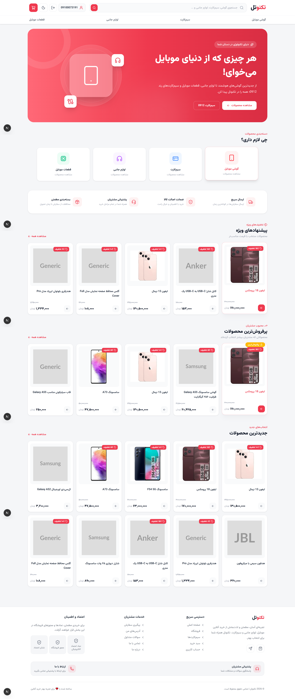
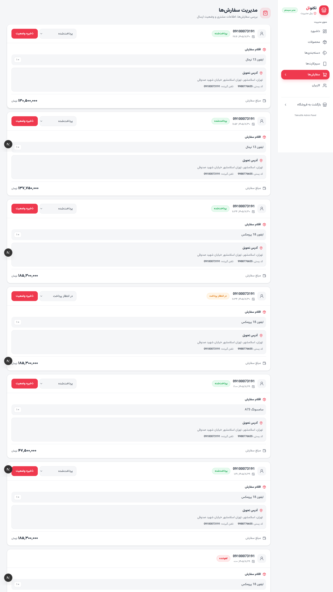

# TeknoTel | E-commerce Platform

A full-stack e-commerce platform built with Next.js, featuring product browsing, authentication, shopping cart, order management, payment integration, and an admin dashboard.

تکنوتل یک فروشگاه اینترنتی فول‌استک است که با Next.js توسعه داده شده و امکاناتی مانند مشاهده محصولات، احراز هویت، سبد خرید، ثبت و مدیریت سفارش‌ها، سیستم پرداخت و پنل مدیریت را ارائه می‌دهد.

---

## Screenshots | تصاویر پروژه

### Home Page | صفحه اصلی



### Product Details | جزئیات محصول


### Admin Dashboard | داشبورد مدیریت


### Product Management | مدیریت محصولات


### Order Management | مدیریت سفارش‌ها



---

## Features | امکانات

### Storefront | فروشگاه

- Responsive design for mobile, tablet, and desktop
- Light and dark mode
- Product catalog and categories
- Product details and specifications
- Product search
- Product variants
- Shopping cart
- Checkout and order creation

- طراحی واکنش‌گرا برای موبایل، تبلت و دسکتاپ
- پشتیبانی از تم روشن و تاریک
- نمایش محصولات و دسته‌بندی‌ها
- صفحه جزئیات و مشخصات محصولات
- جست‌وجوی محصولات
- محصولات دارای تنوع و ویژگی‌های مختلف
- سبد خرید
- ثبت سفارش و فرایند تسویه حساب

### Authentication & User Account | احراز هویت و حساب کاربری

- User authentication
- Google authentication
- OTP verification
- Session management
- User dashboard
- Address management
- Order history

- احراز هویت کاربران
- ورود با حساب گوگل
- تأیید شماره تلفن با کد یک‌بارمصرف
- مدیریت نشست‌های کاربری
- پنل اختصاصی کاربران
- مدیریت آدرس‌ها
- مشاهده سفارش‌های ثبت‌شده

### Admin Panel | پنل مدیریت

- Admin dashboard with statistics
- Product management
- Category management
- Order management
- Customer management
- SIM card number management
- Payment and order status management

- داشبورد مدیریتی همراه با آمار
- مدیریت محصولات
- مدیریت دسته‌بندی‌ها
- مدیریت سفارش‌ها
- مدیریت مشتریان
- مدیریت شماره‌های سیم‌کارت
- مدیریت وضعیت پرداخت و سفارش

### Payment System | سیستم پرداخت

- Payment workflow
- Zarinpal integration
- Payment verification
- Payment status management
- Mock payment mode for development and testing

- فرایند پرداخت
- اتصال به درگاه زرین‌پال
- بررسی و تأیید تراکنش‌ها
- مدیریت وضعیت پرداخت
- پرداخت شبیه‌سازی‌شده برای توسعه و تست

---

## Tech Stack | تکنولوژی‌ها

| Technology      | تکنولوژی       | Purpose          | کاربرد                   |
| --------------- | -------------- | ---------------- | ------------------------ |
| Next.js 16      | نکست‌جی‌اس     | React framework  | فریم‌ورک توسعه           |
| React 19        | ری‌اکت         | UI development   | توسعه رابط کاربری        |
| TypeScript      | تایپ‌اسکریپت   | Type safety      | کاهش خطاهای تایپی        |
| Tailwind CSS 4  | تیلویند        | Styling          | طراحی و استایل‌دهی       |
| PostgreSQL      | پستگرس         | Database         | پایگاه داده              |
| Prisma ORM      | پریزما         | Database ORM     | مدیریت ارتباط با دیتابیس |
| NextAuth.js     | نکست‌آث        | Authentication   | احراز هویت               |
| Zustand         | زوستاند        | State management | مدیریت وضعیت             |
| React Hook Form | ری‌اکت هوک فرم | Form management  | مدیریت فرم‌ها            |
| Zod             | زاد            | Validation       | اعتبارسنجی داده‌ها       |
| Docker          | داکر           | Containerization | اجرای سرویس‌ها           |
| Zarinpal        | زرین‌پال       | Payment gateway  | درگاه پرداخت             |

---

## Installation & Setup | نصب و راه‌اندازی

### 1. Clone the repository | دریافت پروژه

```bash
git clone https://github.com/mohamadshirrdel/TeknoTel.git
cd TeknoTel
```

### 2. Install dependencies | نصب وابستگی‌ها

```bash
npm install
```

### 3. Configure environment variables | تنظیم متغیرهای محیطی

Create a `.env` file in the project root and configure the required environment variables.

یک فایل `.env` در ریشه پروژه ایجاد کرده و متغیرهای محیطی موردنیاز را تنظیم کنید.

### 4. Start PostgreSQL | راه‌اندازی دیتابیس

Make sure PostgreSQL is running and the database is available.

اطمینان حاصل کنید PostgreSQL در حال اجراست و دیتابیس موردنیاز پروژه در دسترس قرار دارد.

### 5. Apply database migrations | اعمال Migrationها

```bash
npx prisma migrate deploy
```

### 6. Generate Prisma Client | تولید Prisma Client

```bash
npx prisma generate
```

### 7. Run the development server | اجرای پروژه

```bash
npm run dev
```

Open the application in your browser:

پروژه را در مرورگر باز کنید:

http://localhost:3000

---

## Development Scripts | دستورات توسعه

| Command         | دستور            | Description                  | توضیحات              |
| --------------- | ---------------- | ---------------------------- | -------------------- |
| `npm run dev`   | اجرای توسعه      | Start development server     | اجرای سرور توسعه     |
| `npm run build` | ساخت پروژه       | Build production application | ساخت نسخه Production |
| `npm start`     | اجرای Production | Start production server      | اجرای نسخه نهایی     |
| `npm run lint`  | بررسی کد         | Run ESLint                   | بررسی کیفیت کد       |

---

## About the Project | درباره پروژه

TeknoTel is a portfolio project developed to practice and demonstrate modern full-stack web development concepts, including responsive UI design, authentication, database integration, product and category management, order processing, and payment workflows.

تکنوتل یک پروژه نمونه‌کار برای تمرین و نمایش مهارت‌های توسعه وب فول‌استک است که در آن مفاهیمی مانند طراحی واکنش‌گرا، احراز هویت، ارتباط با پایگاه داده، مدیریت محصولات و دسته‌بندی‌ها، پردازش سفارش‌ها و پیاده‌سازی فرایند پرداخت به کار گرفته شده‌اند.

---

## Developer | توسعه‌دهنده

**Mohammad Shirdel | محمد شیردل**

GitHub: [@mohamadshirrdel](https://github.com/mohamadshirrdel)
