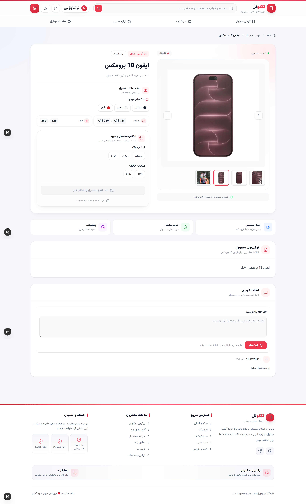
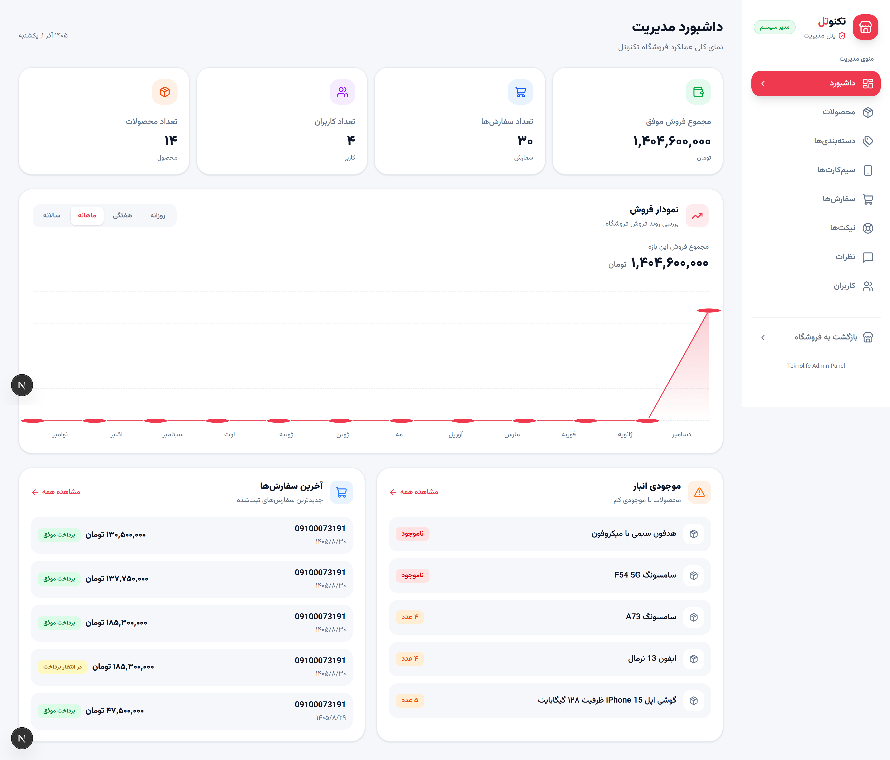
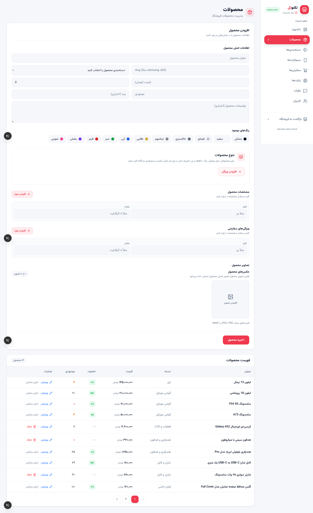

# TeknoTel | Full-Stack E-commerce Platform

A modern full-stack e-commerce platform built with Next.js, featuring product browsing, authentication, product variants, shopping cart, order processing, payment integration, customer support, product reviews, and a comprehensive admin dashboard.

تکنوتل یک فروشگاه اینترنتی فول‌استک مدرن است که با Next.js توسعه داده شده و امکاناتی مانند مشاهده و جست‌وجوی محصولات، احراز هویت، تنوع محصولات، سبد خرید، ثبت و مدیریت سفارش‌ها، سیستم پرداخت، پشتیبانی مشتریان، نظرات کاربران و پنل مدیریت را ارائه می‌دهد.

---

## Screenshots | تصاویر پروژه

### Home Page | صفحه اصلی


### Product Details | جزئیات محصول



### Admin Dashboard | داشبورد مدیریت



### Product Management | مدیریت محصولات



### Order Management | مدیریت سفارش‌ها


---

## Features | امکانات

### Storefront | فروشگاه

- Responsive design for mobile, tablet, and desktop
- Light and dark mode
- Product catalog and categories
- Product details and specifications
- Product search
- Product variants and customizable options
- Shopping cart
- Checkout and order creation
- Product image management

- طراحی واکنش‌گرا برای موبایل، تبلت و دسکتاپ
- پشتیبانی از تم روشن و تاریک
- نمایش محصولات و دسته‌بندی‌ها
- صفحه جزئیات و مشخصات محصولات
- جست‌وجوی محصولات
- محصولات دارای تنوع و گزینه‌های مختلف
- سبد خرید
- ثبت سفارش و فرایند خرید
- مدیریت تصاویر محصولات

### Authentication & User Account | احراز هویت و حساب کاربری

- User authentication
- Google authentication
- OTP verification
- Session management
- User dashboard
- Profile management
- Address management
- Order history

- احراز هویت کاربران
- ورود با حساب گوگل
- تأیید شماره تلفن با کد یک‌بارمصرف
- مدیریت نشست‌های کاربری
- پنل اختصاصی کاربران
- مدیریت اطلاعات حساب
- مدیریت آدرس‌ها
- مشاهده سفارش‌های ثبت‌شده

### Shopping Cart & Orders | سبد خرید و سفارش‌ها

- Shopping cart management
- Product quantity management
- Order creation
- Address selection
- Order status management
- Order history
- Unpaid order expiration handling

- مدیریت سبد خرید
- تغییر تعداد محصولات
- ثبت سفارش
- انتخاب آدرس
- مدیریت وضعیت سفارش‌ها
- مشاهده سوابق سفارش
- مدیریت سفارش‌های پرداخت‌نشده و منقضی‌شده

### Product Management | مدیریت محصولات

- Create, update, and delete products
- Category management
- Product specifications
- Product variants
- Variant-specific pricing and inventory
- Product image management
- Inventory management

- ایجاد، ویرایش و حذف محصولات
- مدیریت دسته‌بندی‌ها
- مدیریت مشخصات محصولات
- مدیریت تنوع محصولات
- مدیریت قیمت و موجودی هر تنوع
- مدیریت تصاویر محصولات
- مدیریت موجودی کالا

### Admin Panel | پنل مدیریت

- Admin dashboard with statistics
- Product management
- Category management
- Order management
- Customer management
- SIM card number management
- Product comment moderation
- Support ticket management
- Payment and order status management

- داشبورد مدیریتی همراه با آمار
- مدیریت محصولات
- مدیریت دسته‌بندی‌ها
- مدیریت سفارش‌ها
- مدیریت مشتریان
- مدیریت شماره‌های سیم‌کارت
- مدیریت و تأیید نظرات کاربران
- مدیریت تیکت‌های پشتیبانی
- مدیریت وضعیت پرداخت و سفارش‌ها

### Payment System | سیستم پرداخت

- Payment workflow
- Zarinpal integration
- Payment request creation
- Payment verification
- Payment status management
- Payment failure handling
- Mock payment mode for development and testing

- فرایند پرداخت
- اتصال به درگاه زرین‌پال
- ایجاد درخواست پرداخت
- بررسی و تأیید تراکنش‌ها
- مدیریت وضعیت پرداخت
- مدیریت پرداخت‌های ناموفق
- پرداخت شبیه‌سازی‌شده برای توسعه و تست

### Customer Support | پشتیبانی مشتریان

- Ticket creation
- Support conversations
- Ticket messages
- Admin replies
- Ticket status management

- ایجاد تیکت پشتیبانی
- گفت‌وگو با پشتیبانی
- ارسال پیام در تیکت
- پاسخ‌دهی توسط مدیر
- مدیریت وضعیت تیکت‌ها

### Product Reviews | نظرات کاربران

- Product comments
- Comment moderation
- Comment approval system
- Admin replies

- ثبت نظر درباره محصولات
- مدیریت نظرات
- سیستم تأیید نظرات
- پاسخ مدیر به نظرات کاربران

### SIM Card Management | مدیریت سیم‌کارت‌ها

- SIM card number management
- Operator management
- Pricing management
- Availability management

- مدیریت شماره‌های سیم‌کارت
- مدیریت اپراتورها
- تعیین قیمت
- مدیریت وضعیت موجودی و فروش

---

## Tech Stack | تکنولوژی‌ها

| Technology      | Purpose                    | تکنولوژی        | کاربرد               |
| --------------- | -------------------------- | --------------- | -------------------- |
| Next.js 16      | Full-stack React framework | Next.js         | فریم‌ورک فول‌استک    |
| React 19        | UI development             | React           | توسعه رابط کاربری    |
| TypeScript      | Type safety                | TypeScript      | کاهش خطاهای تایپی    |
| Tailwind CSS 4  | Styling                    | Tailwind CSS    | طراحی و استایل‌دهی   |
| PostgreSQL      | Relational database        | PostgreSQL      | پایگاه داده رابطه‌ای |
| Prisma ORM      | Database ORM               | Prisma          | مدیریت دیتابیس       |
| NextAuth.js     | Authentication             | NextAuth.js     | احراز هویت           |
| Zustand         | State management           | Zustand         | مدیریت وضعیت         |
| React Hook Form | Form management            | React Hook Form | مدیریت فرم‌ها        |
| Zod             | Validation                 | Zod             | اعتبارسنجی داده‌ها   |
| Docker          | Containerization           | Docker          | مدیریت کانتینرها     |
| Google OAuth    | Social authentication      | Google OAuth    | ورود با گوگل         |
| Zarinpal        | Payment gateway            | زرین‌پال        | درگاه پرداخت         |
| Swiper          | Sliders and carousels      | Swiper          | اسلایدرها            |
| Lucide React    | Icons                      | Lucide React    | آیکون‌ها             |
| Sharp           | Image processing           | Sharp           | پردازش تصاویر        |

---

## Installation & Setup | نصب و راه‌اندازی

### 1. Clone the repository | دریافت پروژه

```bash
git clone https://github.com/mohamadshirrdel/TeknoTel.git
cd TeknoTel
```

### 2. Install dependencies | نصب وابستگی‌ها

```bash
npm install
```

### 3. Configure environment variables | تنظیم متغیرهای محیطی

Create a `.env` file in the project root and configure the required environment variables based on `.env.example`.

یک فایل `.env` در ریشه پروژه ایجاد کرده و متغیرهای محیطی موردنیاز را مطابق فایل `.env.example` تنظیم کنید.

### 4. Configure the database | راه‌اندازی دیتابیس

Make sure PostgreSQL is running and the database connection is correctly configured.

اطمینان حاصل کنید PostgreSQL در حال اجراست و اتصال دیتابیس در متغیرهای محیطی به‌درستی تنظیم شده است.

### 5. Apply database migrations | اعمال Migrationها

```bash
npx prisma migrate deploy
```

### 6. Generate Prisma Client | تولید Prisma Client

```bash
npx prisma generate
```

### 7. Run the development server | اجرای پروژه

```bash
npm run dev
```

Open the application in your browser:

پروژه را در مرورگر باز کنید:

http://localhost:3000

---

## Development Scripts | دستورات توسعه

| Command         | Description                  | توضیحات              |
| --------------- | ---------------------------- | -------------------- |
| `npm run dev`   | Start development server     | اجرای سرور توسعه     |
| `npm run build` | Build production application | ساخت نسخه Production |
| `npm start`     | Start production server      | اجرای نسخه نهایی     |
| `npm run lint`  | Run ESLint                   | بررسی کیفیت کد       |

---

## Project Structure | ساختار پروژه

```text
TeknoTel/
├── prisma/
│   ├── migrations/
│   ├── schema.prisma
│   └── seed.ts
│
├── public/
│   └── screenshots/
│
├── src/
│   ├── actions/
│   ├── app/
│   │   ├── (auth)/
│   │   ├── (shop)/
│   │   ├── admin/
│   │   ├── dashboard/
│   │   └── api/
│   │
│   ├── components/
│   │   ├── admin/
│   │   ├── auth/
│   │   ├── dashboard/
│   │   ├── layout/
│   │   ├── providers/
│   │   ├── shop/
│   │   └── support/
│   │
│   ├── lib/
│   ├── store/
│   └── types/
│
├── scripts/
├── package.json
├── prisma.config.ts
└── README.md
```

---

## About the Project | درباره پروژه

TeknoTel is a portfolio project developed to practice and demonstrate modern full-stack web development concepts. It includes responsive UI development, authentication, database integration, product and category management, product variants, shopping cart functionality, order processing, payment workflows, customer support, product reviews, and administrative tools.

تکنوتل یک پروژه نمونه‌کار برای تمرین و نمایش مهارت‌های توسعه وب فول‌استک است که در آن مفاهیمی مانند طراحی واکنش‌گرا، احراز هویت، ارتباط با پایگاه داده، مدیریت محصولات و دسته‌بندی‌ها، تنوع محصولات، سبد خرید، پردازش سفارش‌ها، پیاده‌سازی فرایند پرداخت، سیستم پشتیبانی مشتریان و ابزارهای مدیریتی به کار گرفته شده‌اند.

---

## Developer | توسعه‌دهنده

**Mohammad Shirdel | محمد شیردل**

GitHub: [@mohamadshirrdel](https://github.com/mohamadshirrdel)
